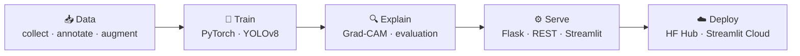
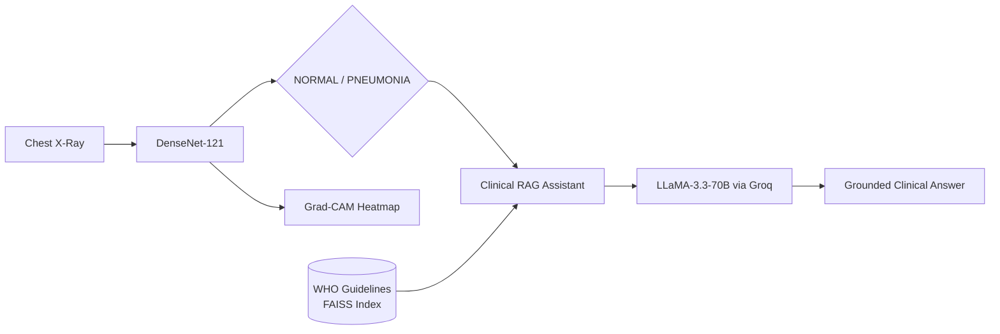
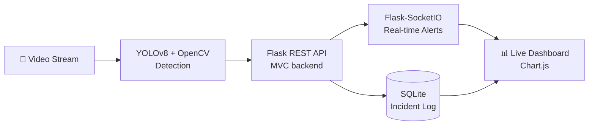
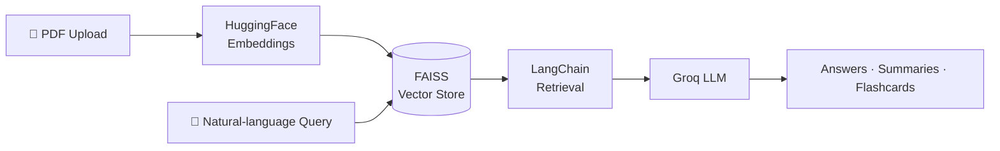
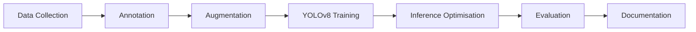

 

## 👨‍💻 About Me

I'm a final-year **B.E. student in Artificial Intelligence & Machine Learning** at **AMC Engineering College, Bengaluru (VTU)**. I build AI systems that go beyond notebooks: models that are **trained, explained, wrapped in APIs, and deployed**.

My work sits at the intersection of **computer vision**, **deep learning**, and **LLM-powered retrieval (RAG)**, with a strong interest in **Explainable AI for healthcare**.

<table>
<tr>
<td align="center" width="20%"><h2>0.96+</h2>AUC-ROC MediScan AI</td>
<td align="center" width="20%"><h2>90.2%</h2>Test Accuracy MediScan AI</td>
<td align="center" width="20%"><h2>5,863</h2>Chest X-rays used for training</td>
<td align="center" width="20%"><h2>4</h2>End-to-end AI projects</td>
<td align="center" width="20%"><h2>3</h2>Industry certifications</td>
</tr>
</table>

<table>
<tr>
<td width="50%" valign="top">

**🎓 Education**
B.E. in AI & ML · 2023 – 2027
AMC Engineering College · VTU
CGPA: **7.8**

</td>
<td width="50%" valign="top">

**🎯 Focus Areas**
Computer Vision · Deep Learning
NLP · RAG Pipelines · Explainable AI
Model Deployment · REST APIs

</td>
</tr>
</table>

---

## 🧬 How I Build

Every project follows the same end-to-end discipline, from raw data to something a user can actually open.

---

## 🚀 Featured Projects

### 🫁 MediScan AI — Chest X-Ray Disease Detection
> **Explainable medical imaging + a RAG-powered Clinical Assistant**

A pneumonia detection system built on a fine-tuned **DenseNet-121**. Every prediction ships with a **Grad-CAM heatmap** showing which lung regions drove the decision, plus a **Clinical RAG Assistant** grounded in **WHO pneumonia guidelines**.

| 📊 AUC-ROC | 🎯 Test Accuracy | 🖼️ Training Images | 🧠 Backbone |
|:---:|:---:|:---:|:---:|
| **0.96+** | **90.2%** | **5,863** | **DenseNet-121** |

### 🗑️ Edge AI Camera System for Illegal Waste Dumping Detection
> **Real-time detection with a REST API backend and a live analytics dashboard**

- Real-time object detection pipeline using **YOLOv8** and **OpenCV**, running inference on live video streams
- **Flask REST API** backend with a live web dashboard powered by **Chart.js**
- **Flask-SocketIO** for real-time alert streaming, **SQLite** for structured incident logging
- Modular **MVC architecture**, unit tested with **pytest**

### 🧠 AI Knowledge Workspace — RAG + LLM
> **Chat with your PDFs using Retrieval-Augmented Generation**

Upload a PDF and query it in natural language. The app combines **semantic search** over vector embeddings with LLM generation, and adds **document summarisation** and **AI-generated flashcards** for studying.

### 🎣 Ghost Fishing Gear Detection — YOLOv8
> **Computer vision for marine conservation**

Custom **YOLOv8** model trained on a **self-annotated marine dataset** to detect abandoned ghost fishing gear, reaching **70% validation accuracy**. I owned the full ML lifecycle independently.

## 🛠️ Tech Stack

<b>🤖 AI / ML & Deep Learning</b>

 

-FF6F00?style=for-the-badge&logo=tensorflow&logoColor=white)

<b>💬 NLP & RAG</b>

 

<b>⚙️ Backend, Data & Tools</b>

 

-2496ED?style=for-the-badge&logo=docker&logoColor=white)

<b>☁️ Cloud & Platforms</b>

 

---

## 📜 Certifications

| Certification | Issuer | Year |
|:---|:---:|:---:|
| 🏅 Oracle Cloud Infrastructure 2025 — **AI Foundations** | Oracle | 2025 |
| 🏅 Oracle Cloud Infrastructure 2025 — **Generative AI** | Oracle | 2025 |
| 🏅 HackerRank Certified — **Python (Problem Solving)** | HackerRank | 2024 |

---

## 🎯 What I'm Looking For

<table>
<tr>
<td width="33%" valign="top">

**💼 Roles**
Fresher AI/ML Engineer and internship roles in computer vision, deep learning, or LLM / RAG applications.

</td>
<td width="33%" valign="top">

**📍 Location**
Bengaluru or remote.

</td>
<td width="33%" valign="top">

**🌐 Languages**
English · Telugu · Hindi · Kannada

</td>
</tr>
</table>

---

### 📫 Let's Build Something Together

